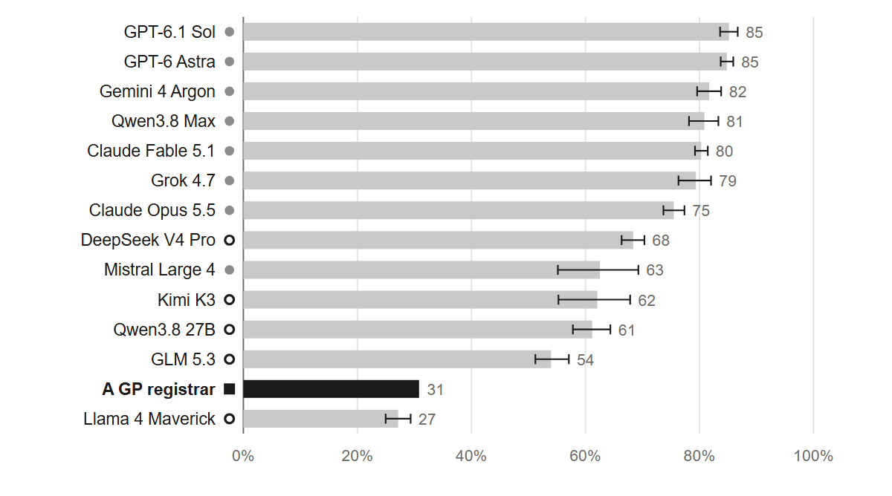
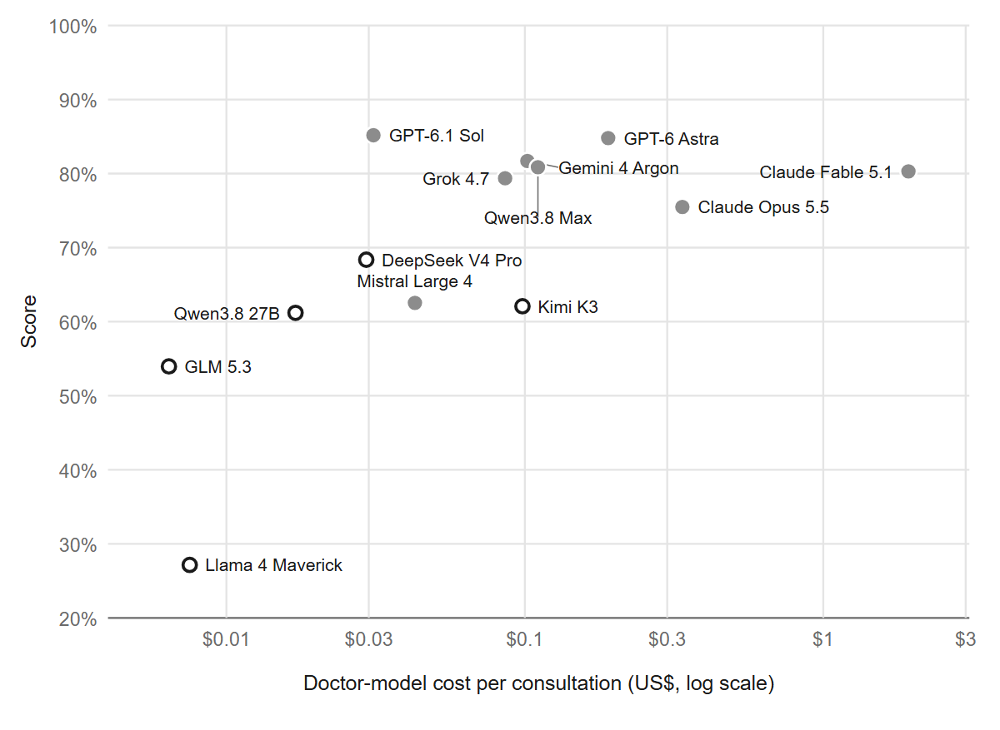
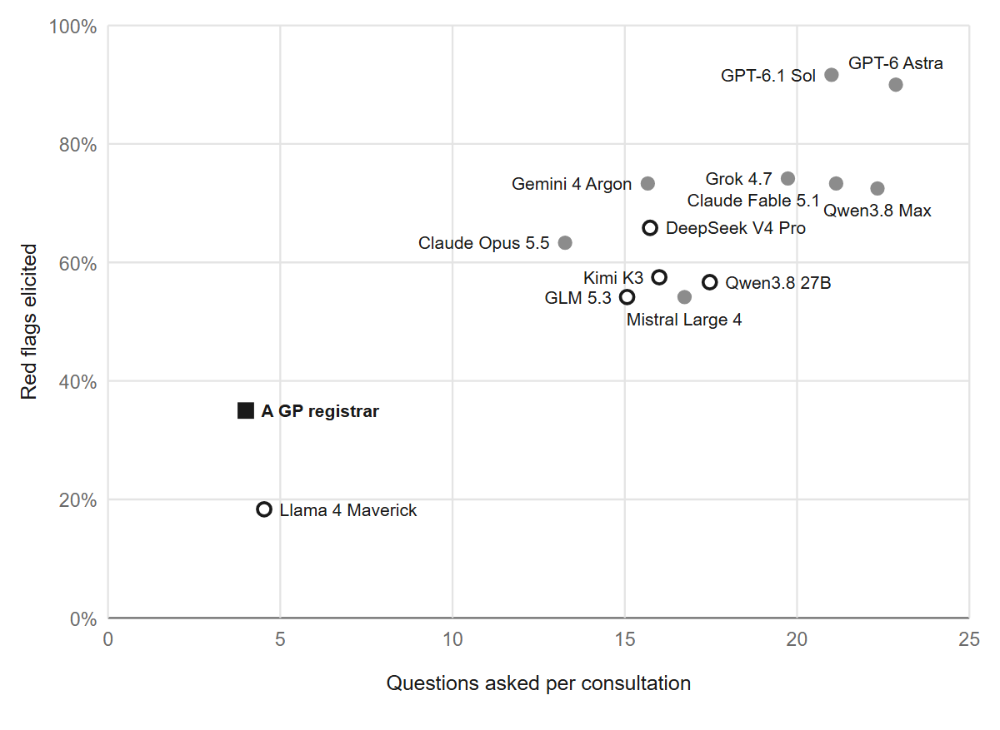
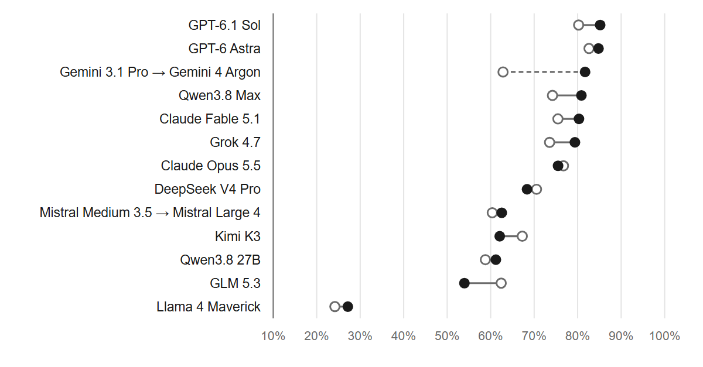

# crook-bench

How do AI models do as the doctor in a GP consultation game?

*Crook* is a game in which you are a general practitioner (family doctor) in
Australia: you talk to a patient in your own words, examine them, order
tests, prescribe or refer, and commit to a diagnosis. This repository lets a
language model sit in the doctor's chair and play the same consultations a
human player does, scored by the game's own code.

This is a benchmark of a game, not of medical competence. A score here says
how a model plays *Crook*'s cases under *Crook*'s marking. It says nothing
about whether a model can or should practise medicine.

## Results

**Interactive results:** https://woodytwoshoes.github.io/crook-bench/: sort the leaderboard by any column, filter by lab or open weights, click a model to highlight it everywhere and split its point into its consultations, compare the two runs, and read any consultation's transcript, bill and move log.

Latest run: **21 October 2026**, against the live game's patient (Gemini 3.1 Flash-Lite classifier, Gemini 3.5 Flash-Lite voice and judge) and the game's scoring of that date.



| Rank | Model | Consults | Score % (±sd) | History | Exam | Tests | Mgmt + dx | Red flags caught | Questions asked | Red flags per 10 questions | Top dx right | Harms per consult | Required care missed | Cost per consult |
|---|---|---|---|---|---|---|---|---|---|---|---|---|---|---|
| 1 | openai/gpt-6.1-sol | 15 (5 cases) | 85 (±10) | 82 | 78 | 100 | 93 | 92% | 21 | 3.5 | 100% | 0.00 | 0 | $0.03 |
| 2 | openai/gpt-6-astra | 15 (5 cases) | 85 (±9) | 81 | 79 | 100 | 93 | 90% | 23 | 3.2 | 100% | 0.00 | 0 | $0.19 |
| 3 | google/gemini-4-argon | 15 (5 cases) | 82 (±9) | 73 | 93 | 100 | 89 | 73% | 16 | 4.0 | 100% | 0.00 | 0 | $0.10 |
| 4 | qwen/qwen3.8-max-0902 | 15 (5 cases) | 81 (±10) | 70 | 80 | 94 | 97 | 73% | 22 | 2.6 | 100% | 0.07 | 0 | $0.11 |
| 5 | anthropic/claude-fable-5.1 | 15 (5 cases) | 80 (±7) | 72 | 85 | 100 | 89 | 73% | 21 | 2.9 | 100% | 0.20 | 0 | $1.93 |
| 6 | x-ai/grok-4.7 | 15 (5 cases) | 79 (±8) | 71 | 87 | 100 | 88 | 74% | 20 | 3.2 | 100% | 0.07 | 1 | $0.09 |
| 7 | anthropic/claude-opus-5.5 | 15 (5 cases) | 75 (±12) | 65 | 79 | 100 | 91 | 63% | 13 | 3.9 | 100% | 0.00 | 0 | $0.34 |
| 8 | deepseek/deepseek-v4-pro-0813 | 15 (5 cases) | 68 (±13) | 61 | 74 | 78 | 74 | 66% | 16 | 4.3 | 100% | 0.33 | 0 | $0.03 |
| 9 | mistralai/mistral-large-4-0 | 15 (5 cases) | 63 (±27) | 54 | 74 | 78 | 59 | 54% | 17 | 2.9 | 80% | 0.07 | 3 | $0.04 |
| 10 | moonshotai/kimi-k3 | 15 (5 cases) | 62 (±18) | 55 | 70 | 56 | 71 | 58% | 16 | 2.9 | 93% | 0.27 | 0 | $0.10 |
| 11 | qwen/qwen3.8-27b | 15 (5 cases) | 61 (±9) | 57 | 75 | 94 | 54 | 57% | 17 | 2.7 | 100% | 0.13 | 1 | $0.02 |
| 12 | z-ai/glm-5.3 | 15 (5 cases) | 54 (±9) | 47 | 59 | 47 | 63 | 54% | 15 | 3.4 | 100% | 0.20 | 1 | $0.01 |
| 13 | meta-llama/llama-4-maverick | 15 (5 cases) | 27 (±11) | 26 | 34 | 67 | 22 | 18% | 5 | 2.7 | 100% | 0.33 | 3 | $0.01 |
| – | *A GP registrar* (human reference) | 5 (5 cases) | 31 (±6) | 20 | 61 | 63 | 28 | 35% | 4 | 5.7 | 100% | 0.20 | 1 | – |

Score is the mean share of each case's maximum. History, Exam, Tests and
Mgmt + dx are the bill's four parts, each out of its own maximum. The GP
registrar (a co-author of the paper) played each free case once on the live
game, briskly, on 11–12 October; their consultations were replayed under the
21 October rules. Five consultations by one person are a reference point, not
a human baseline. Every consultation's transcript, bill and move log is in
[`results/2026-10-21/`](results/2026-10-21/); the first run is in
[`results/2026-10-04/`](results/2026-10-04/).







**What stood out**

- **Diagnosis doesn't separate the models.** The most likely diagnosis was
  right in 191 of 195 consultations; the other four ended with no diagnosis
  because the model stopped calling tools (Mistral Large 4 three times, Kimi
  K3 once). The process does separate them: red flags asked about, a safe
  prescription, and sending the patient to the right place.
- **Red flags followed questions** (r = 0.88 across models). No model came
  near the 50-question budget.
- **The record is not the patient.** The patient allergic to penicillin
  (record: "nil known") was given penicillin in 16 of 39 consultations; in 14
  the doctor never asked about allergies. GTN was given after sildenafil 5
  times, each without asking about other medicines.
- **Price and score are loosely related.** GPT-6.1 Sol scored 85% at about
  US$0.03 a consultation; Claude Fable 5.1 80% at about US$1.93.
- **The ranking held between runs** (Spearman 0.92 over the 11 models in
  both), though the patient model, the scoring rules and the cases all
  changed. Gemini 4 Argon scored 82% where Gemini 3.1 Pro had scored 63%.

**Run:** 2026-10-21. 13 models × 5 cases × 3 consultations = 195, through
OpenRouter at each provider's defaults (Llama 4 Maverick with
`tool_choice: "required"`, below), on the game's server. Budget: 50
questions. Doctor-model cost about US$45. The first run (2026-10-04) used
Qwen3 8B as patient, classifier and judge, and the rules of that date; its
leaderboard is in [`results/2026-10-04/LEADERBOARD.md`](results/2026-10-04/LEADERBOARD.md).
Open weights: Mistral Medium 3.5 was listed as closed in the first run's
charts; its weights are on Hugging Face, and the site now shows it as open.

## Method

**The doctor** is the model under test. It acts only through tools: `say`
(talk to the patient), `list_exams` and `search` (find exams, tests, drugs,
referrals and diagnoses), `examine`, `order_test`, `prescribe`, `refer`,
`diagnose` (most likely, a differential, and a can't-miss diagnosis) and
`end_consult`. It sees what a player sees: the patient's name, age and
booking, the clinic record, its own findings and results. It never sees the
case file or the points.

**The patient** is the game's own patient model (Gemini Flash-Lite on 21
October, Qwen3 8B on 4 October), on the game's
server, the same one human players talk to. It plays a person from a
private chart and does not know its diagnosis. A separate classifier call
(same model) decides which history items each question asked about, and only
those facts are released to the patient. A question it misses gets a denial,
as it would for a human player.

**The score** is decided by code against a hand-written key, exactly as for
a human player: red flags asked about, key history, indicated exams and
tests, a safe plan, and a defensible diagnosis. Process, not outcome: the
question is whether the consultation was safe and well targeted given what
the doctor had found when they committed. Unnecessary tests cost points
(more for each further one); harmful actions cost a lot. Spoken advice and
the plan are judged at the end from the doctor's own words, by the patient
model quoting what was said, with code checking the quote was really said.

**The time budget** is 50 questions per consultation. Each question counts,
including several in one message. Explanations, the plan and safety-netting
are free, as are examining, tests, prescribing, referring and diagnosing.
Asking questions is never penalised in itself: the budget only stops a model
from asking everything.

**Efficiency columns.** *Questions asked* is the mean per consultation.
*Red flags per 10 questions* is red flags elicited ÷ questions asked × 10,
averaged over consultations that asked any.

**Runs.** Five cases (the game's free cases), three consultations each per
model, through OpenRouter with each provider's default settings. Llama 4
Maverick wrote its tool calls as plain text under `tool_choice: "auto"`, so
it ran with `tool_choice: "required"`; every other model ran with `auto`.

## Caveats

- **All cases are drafts** (`status: draft`), written with AI help from
  standard references and still under review by the game's author, a GP
  registrar. Management follows Australian practice (eTG, PBS), which may
  differ from where you are.
- **The patient and the marker are small models** (Gemini Flash-Lite on 21
  October, Qwen3 8B on 4 October). It misses some questions
  (the classifier's held-out recall is about 90%) and the end-of-consult
  judge sometimes credits or misses a spoken item. Every model faces the same
  patient, but the noise is real: see known issues.
- **Three runs per case is a small sample.** The ± column is the standard
  deviation across a model's consultations.
- The developer wrote the cases. The one human reference point (a GP registrar,
  five consultations) is not a human baseline.

## Known issues

- B1 chest_pain_stemi: "Stay with the patient with a defibrillator available" is judged inconsistently: credited for "The ambulance crew will stay with you the whole way" (DeepSeek, pilot), not for "I'll stay with you and keep the heart monitor on" (Opus, pilot).
- B2 abdo_pain_appendicitis: the required ED item accepts only the ambulance or self-present referral. Phoning ED for a handover and telling the patient to go now by taxi (Grok rep 3) loses 30 and gets the missed-red-flag story ("looked like a stomach bug") though appendicitis was diagnosed. Fixed 2026-10-04 (developer's decision): the item accepts phone_ed_handover; the five affected consults (DeepSeek, Grok, GLM ×2, Qwen3.8 27B) rescored from their logs, +45 each.
- B3 back_pain_mechanical: the spoken-plan judge gave −30 for "Bed rest" to advice against it: "the worst thing for this is lying on the couch all day" and "Bed rest slows recovery." Open.
- B4 abdo_pain_appendicitis: −30 for "Pain relief and home without a diagnosis" on "I'll give you some paracetamol now to take the edge off the pain on the way" (to hospital). Open.
- B5 cough_pneumonia: "Any allergies to medicines?" can go to the generic `other_allergies` decoy instead of `antibiotic_allergy`, so the patient denies his penicillin allergy; the doctor then prescribes amoxicillin and takes −30. 2 of 39 consults (Gemini 3.1 Pro #3, Grok 4.7 #2); 23 of the 26 consults that asked were answered correctly. Suggested fix: `covers: [other_allergies]` on `antibiotic_allergy`, checked with `eval:sweep`. Open.
- B6 all: the question budget counts sentences ending in "?" and "tell me…" requests, so a question worded as a statement ("I'd like to know whether…") is free. Not exploited: 1 of 227 point-earning turns counted as no question (checked mid-run). Open.
- B7 all: talking is free, so a model could list every plausible piece of advice and collect the plan items; harmful ones still cost 30. Not checked systematically. Open.

## Running it

```sh
npm ci
export OPENROUTER_API_KEY=...            # the doctor models
export PATIENT_URL=http://localhost:1234/v1   # any OpenAI-compatible server running qwen/qwen3-8b
npm run bench -- run <openrouter-model-id> --cases free --reps 3
npm run bench -- report                  # writes bench-results/LEADERBOARD.md
npm run bench -- rescore                 # rescore saved consults against the current cases, no model calls
```

Options: `--questions 50` (the budget), `--concurrency 2`, `--out
bench-results`. `DOCTOR_URL` and `DOCTOR_KEY` point at any other
OpenAI-compatible API; `DOCTOR_EXTRA` merges JSON into each request (e.g.
`{"tool_choice":"required"}`). Tests: `npx vitest run`.

## Licence and contact

The code (`packages/`) is MIT. The case files and catalogue are all rights reserved, published so results can be checked and reproduced: see `cases/LICENSE`.

The game: https://doctorfoo.ai
